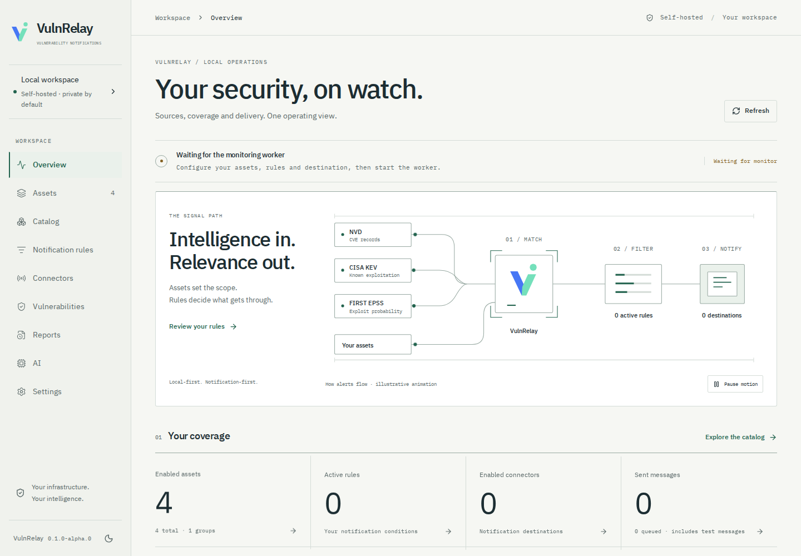

# VulnRelay

**Know what matters. Get notified.**

VulnRelay is a self-hosted vulnerability notification engine. Tell it which
products and packages you use, select the conditions that matter to you, and
receive relevant CVE alerts in your existing channels. The worker keeps
monitoring while the optional local web interface is closed. No cloud account
or AI provider is required.

> **Alpha software:** the core is under active development, not a supported v1
> production release. A real Telegram test message has been received; a
> controlled real CVE-alert, restart and recovery acceptance is still open.
> Keep the interface on localhost and review the [known limitations](#limitations).

[Quick start](#quick-start) · [Documentation](docs/README.md) ·
[Deutsch: Installation und Test](docs/schnellstart.md) ·
[Contributing](CONTRIBUTING.md) · [Security](SECURITY.md)



*A browser-test screenshot with synthetic data. The monitoring worker is
intentionally stopped in this image.*

## How it works

1. **Choose your inventory.** Add vendors, products, CPEs or explicit
   keywords; pick from the offline catalog; or declare exact package versions.
2. **Set rules and destinations.** Combine asset groups, CVSS, EPSS, CISA KEV
   and other conditions. Choose where and when notifications are delivered.
3. **Let the worker run.** VulnRelay synchronizes public intelligence, explains
   matches and routes eligible alerts through a persistent delivery queue.

VulnRelay monitors public vulnerability information and user-declared
inventory. It does not scan networks, discover installed software or execute
exploit code.

## Quick start

Use a Linux host with Git, Docker Engine, **Docker Compose 2.24 or later**,
permission to access Docker and outbound HTTPS. The first image build and
source synchronization take time. The public repository can be cloned over
HTTPS without a GitHub account.

```sh
git clone https://github.com/LuPetro/vulnrelay.git
cd vulnrelay
cp .env.example .env
chmod 600 .env
docker compose up -d --build --wait --wait-timeout 180
docker compose ps
```

Open **http://localhost:8080** on the host. On a remote server, use an SSH
tunnel to its localhost port; do not expose the application directly to the
Internet. For the full walkthrough, see the [Docker quick start](docs/quickstart.md)
or [German server guide](docs/schnellstart.md). The commands above are for a
fresh checkout: never replace an existing `.env` during an update.

In the UI:

1. Open **Catalog** or **Assets** and add one technology you want to monitor.
2. Use **Connectors → Set up Telegram**, or add another connector and queue a test message. Credentials
   belong in the server's `.env`; the form stores their environment variable names.
3. Under **Notification rules**, select your assets and destination, set
   conditions, and test the rule against stored CVEs before enabling it.
4. Leave the monitor running and check **Overview** for source health, queued
   messages and delivery errors. The first run can match CVEs already in the
   initial synchronization window.

The test message verifies a destination, not the complete matching pipeline.
Use the [real-alert acceptance checklist](docs/acceptance.md) before relying on
notifications. The persistent Docker volume contains the inventory, queue and
database; [back up before upgrading](docs/backup-and-upgrade.md).

## Capabilities

| Area | Current implementation |
| --- | --- |
| Intelligence | Incremental NVD data, CISA KEV and FIRST EPSS; optional OpenCVE enrichment and OSV package lookups. |
| Inventory | Vendor/product, CPE, explicit keyword and exact package/version assets; groups, context, catalog and environment packs. |
| Rules | Nested AND/OR/NOT conditions, missing-data handling, rule testing and matching evidence. |
| Delivery | Telegram, Discord, Slack, SMTP email, ntfy, Gotify and a generic JSON webhook; queue history, retries and per-connector delivery hours. |
| News | Opt-in headlines from official advisories, security news and threat researchers, with topic filters and notifications through existing connectors. |
| Reports | Daily or weekly worldwide or asset-relevant CVE reports based on locally synchronized NVD records. |
| AI | Optional source-based alert summaries through OpenAI, Anthropic or a compatible API. Disabled by default; not used for matching. |
| Operation | Docker Compose or native Python, SQLite, a headless CLI, local UI and packaged migrations. |

See the [documentation index](docs/README.md) for setup, connector-specific
instructions, rules, API/CLI usage, troubleshooting and contributor guides.

## Limitations

- **Match confidence is not proof of exposure.** Product and keyword matches
  are potential; unverified version applicability is unknown. A confirmed
  source match still depends on the inventory you declared being accurate.
  Generic version-range evaluation and qualified package URLs are unfinished.
- **Coverage is bounded.** NVD's initial synchronization uses the last seven
  modified days, not a full historical import. Sources can be incomplete or
  unavailable. OSV checks six ecosystems at exact declared versions and
  currently correlates only advisories with CVE identifiers or aliases.
- **Metrics mean different things.** CVSS describes severity; EPSS estimates
  exploitation probability; CISA KEV records known exploitation. Missing data
  remains unknown rather than being treated as zero.
- **Delivery is at least once.** Unchanged events for the same CVE, asset,
  rule and destination are deduplicated. Multiple matching assets or rules,
  material changes, or a crash after provider acceptance can produce another
  message. Queue history and delivery-hour controls are visible in the UI.
- **Local access only.** An optional API bearer token is not a complete remote
  authentication model. PostgreSQL and native Windows monitoring have not
  been validated for release. See the [security policy](SECURITY.md).

## Development and project status

Copyright 2026 LuPetro and the VulnRelay contributors. The source is
[Apache-2.0 licensed](LICENSE); see [NOTICE](NOTICE) for attribution and
[licensing](docs/licensing.md) for a plain-language explanation. CI runs backend, frontend, browser and
container checks without real credentials. See [contributing](CONTRIBUTING.md),
the [roadmap](PROJECT_PLAN.md), [changelog](CHANGELOG.md) and
[release checklist](docs/releasing.md). New integrations and optional AI need
operator acceptance against the actual services in use.

Source attribution: [NVD](https://nvd.nist.gov/developers/vulnerabilities),
[CISA KEV](https://www.cisa.gov/known-exploited-vulnerabilities-catalog),
[FIRST EPSS](https://www.first.org/epss/data) and [OSV](https://osv.dev/).
VulnRelay uses NVD data but is not endorsed or certified by NVD.
