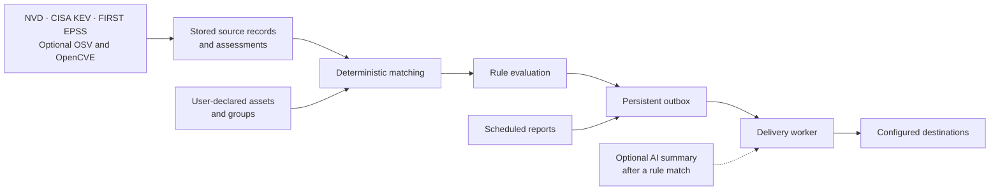

# Architecture

VulnRelay separates collection, matching and delivery. The web interface is an
optional local client; the CLI and API use the same application services and
database. A separate monitor process runs synchronization, rule evaluation,
report scheduling and a delivery thread.

## Intelligence and matching

NVD ingestion stages downloads before committing records and checkpoints
together; bounded windows and overlap support recovery. The first NVD sync
starts with the last seven modified days rather than importing the full
history. CISA KEV snapshots and FIRST EPSS measurements retain their own
provenance. Source failures are recorded independently and do not intentionally
erase the last good data. NVD/KEV run at the configured interval and EPSS
refreshes daily. Slow sources can delay other synchronization and rule
evaluation; a separate delivery thread can continue sending queued work.

The opt-in [OSV adapter](osv.md) looks up declared exact package versions,
keeps per-asset snapshots and currently correlates only CVE identifiers and
aliases. [OpenCVE](opencve.md) supplies a separate optional assessment; NVD is
primary when both have a score. Neither source turns an identity-only match
into proof that an installed version is affected.

Matching strategies return a method, confidence and evidence. Rule expressions
use three-valued logic so missing information does not silently become a known
negative. General version-range evaluation is unfinished; see the
[configuration guide](configuration.md) for current matching boundaries.

## Notifications and reports

Eligible matches are inserted into a persistent, deduplicated outbox. Before
delivery, the worker rechecks the rule, asset and destination; stale entries
can be cancelled. Claims have expiring leases, failed requests are classified
for retry, and destination windows and provider cooldowns are persisted.
Delivery is **at least once**: a crash after a provider accepts a message but
before local acknowledgement can result in a duplicate.

Telegram, Discord, Slack, SMTP, generic webhook, ntfy and Gotify use the same
queue, with connector-specific validation and delivery. Credentials are
referenced through server environment variables, not stored in connector
documents. Messages leave the host and can contain asset names; see the
[security policy](../SECURITY.md).

[Daily and weekly reports](reports.md) use the same outbox but have separate
schedules. Their worldwide and asset-relevant views are limited to locally
synchronized NVD records and a bounded candidate scan; they do not invoke AI.

## Optional AI and storage

AI is off by default and does not make matching or routing decisions. For an
eligible alert, optional summaries use the public CVE identifier and source
description after deterministic filtering; a failed request falls back to the
source-based message. Generated content is labeled and unverified. Provider
connection tests are real requests and can incur charges. See [AI](ai.md).

SQLite in WAL mode is the supported default. Packaged Alembic migrations update
the schema, and the monitor uses a database-specific lock with persisted
next-run state. PostgreSQL support is provisional pending its integration
suite. Neither the worker heartbeat nor a successful request to a source
guarantees complete or current vulnerability coverage.

To extend the pipeline, implement and test a source adapter, explicit matching
strategy or connector without bypassing provenance, uncertainty, retry and
secret-redaction rules. Automated tests must use synthetic data and mocked
providers; see [development](development.md) and [contributing](../CONTRIBUTING.md).
