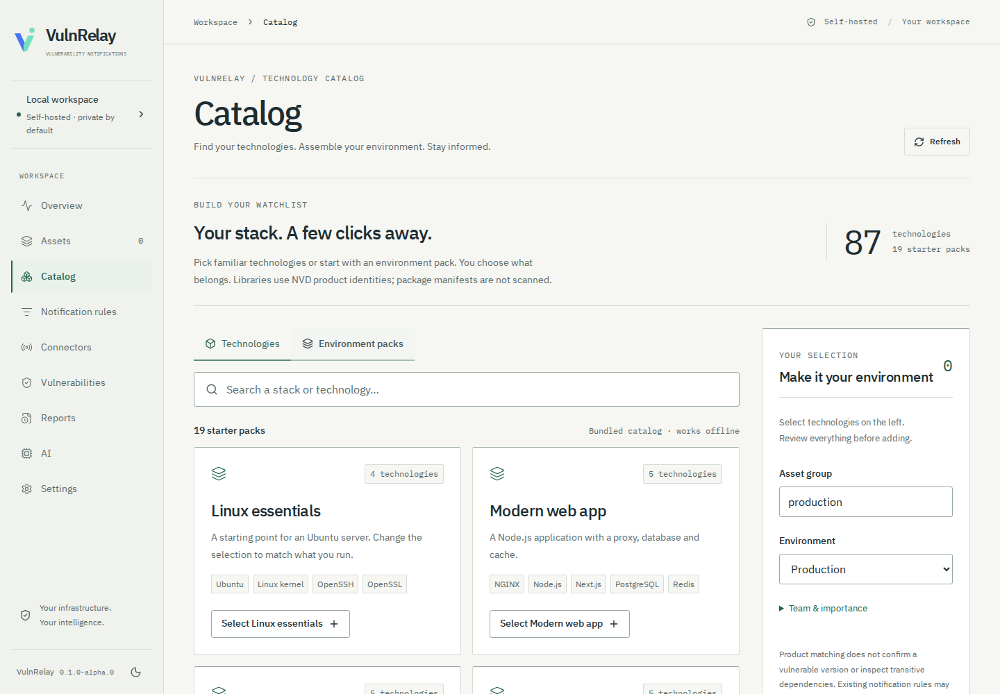

# Technology catalog and environment packs

The **Catalog** page offers **87 bundled technologies and 19 editable starter packs**. It works offline and requires no external catalog account. Choose infrastructure, applications, network devices, identity providers, databases or common libraries instead of typing their matching identities. Manual asset creation remains available.



*Catalog view captured by an automated browser test using synthetic data.*

1. Search a technology or select a category. **Matching identity** shows the exact product/vendor used and links to an NVD identity record or dictionary search. Searches also understand terms included in the descriptions, such as `npm lodash`, `PyPI fastapi` and `Composer laravel`.
2. Alternatively open **Environment packs**. A pack shows its components before selection. Remove anything you do not run and add other technologies individually.
3. Choose an asset group and environment. Team, importance and Internet exposure are optional context.
4. **Review selection** shows new and already-present assets without writing anything. A context change requires a new review.
5. **Add assets** saves the selection in one transaction. The Assets page can search names, products, groups and environments. Existing manual add/edit remains available.

On smaller screens, **Review N selected** takes you directly to your selection and environment settings. It does not import anything.

Packs are examples, not automatic inventory discovery or a claim that a stack is complete. No software is installed on your server. Catalog items use explicit product identities, never automatic fuzzy matching. A product match is potential; it does not confirm that an installed version is vulnerable. Add installed versions by editing the resulting assets, keeping the existing version-matching limitations in mind. CMS plugins, Java distributions and Docker Desktop need their own appropriate entries. Product-only entries intentionally cover vendor renames and disclose their broader scope.

Existing enabled rules may apply to new assets immediately, particularly rules selecting all assets or an existing group. Review your rules before importing a large selection. Catalog imports do not create rules or connectors, change existing settings, or directly enqueue alerts.

## What can I monitor?

The original ten packs remain available with their existing IDs and components. Nine additional packs cover common operating environments:

| Pack | Components to review |
| --- | --- |
| Identity & access | Keycloak, authentik, Authelia, Vaultwarden, PostgreSQL |
| Home services | Home Assistant, Jellyfin, Immich, PostgreSQL, Redis |
| Team collaboration | Nextcloud, Mattermost, Rocket.Chat, Roundcube, PostgreSQL |
| Small network & DNS | OPNsense, pfSense CE, MikroTik RouterOS, UniFi Network, OpenVPN Community, AdGuard Home, Pi-hole Core |
| Python APIs & libraries | Python, FastAPI, Flask, Requests, urllib3, PyYAML, PostgreSQL |
| JavaScript application | Node.js, Express, Next.js, Vite, Axios, Lodash |
| Java service | Oracle JDK, Spring Framework, Tomcat, Log4j, PostgreSQL |
| Data services | PostgreSQL, MariaDB, Redis, Memcached, MinIO, RabbitMQ Server |
| Files & backups | Samba, Syncthing, MinIO, Proxmox Backup Server |

A pack is a selection shortcut: frameworks, firewalls and identity providers can be alternatives, so remove anything you do not run. Packs are editable before import. They never install software, replace an existing selection or imply that all components are required.

Libraries and frameworks use the same explicit **NVD vendor/product identity** matching as other catalog entries. An npm/PyPI/Composer name in a description helps you find the item; it does not turn that catalog entry into an OSV package asset or enable lockfile analysis, SBOM scanning, automatic transitive dependency discovery or version-range validation. You can separately add exact-version package assets manually or through [package URL import](package-import.md). Only relevant records actually synchronized into VulnRelay can match, and upstream CVEs without usable product identities can be missed. Read each alert's evidence and advisory before deciding whether your installed version is affected.

The 37 added identities were reviewed against linked primary NVD records; see [catalog provenance and identity limitations](catalog-sources.md). Current and legacy vendor/product names can differ. In particular, RabbitMQ Server uses `broadcom / rabbitmq_server`, UniFi Network uses `ui / unifi_network_application`, Vaultwarden uses `dani-garcia / vaultwarden`, and Requests/urllib3 use the NVD vendor `python`. Catalog import does not add undocumented aliases. Separate assets may be needed to follow legacy identities, editions, plugins or component-specific records. Existing asset identities are never rewritten by a catalog update.

## Duplicate handling

Repeated IDs in one selection are collapsed. A repeated or overlapping import reuses existing assets with the same matching strategy, vendor/product identity, version, CPE/keyword, group, environment and team. This includes matching manually created entries. Names, importance, exposure, tags and enabled state of existing entries are preserved; importing a disabled asset does not re-enable it. Different environments, teams, versions or matching strategies remain separate inventory entries. Existing duplicate manual entries are not automatically merged or deleted.

Imports serialize the read-and-insert transaction, so simultaneous imports cannot create copies of the same catalog identity/context. A failed insert rolls back the entire selection. This is separate from CVE ingestion deduplication and notification deduplication. Different matching assets or rules can legitimately produce distinct alerts for the same CVE.

## CLI

Use these commands inside the installed environment, or prefix them with `docker compose exec vulnrelay`:

```sh
vulnrelay catalog list --query postgres
vulnrelay catalog list --query "npm lodash"
vulnrelay catalog pack python-api --group application --environment staging --preview
vulnrelay catalog pack linux-server --group servers --environment production --preview
vulnrelay catalog pack linux-server --group servers --environment production
```

For an individually selected list, save a file such as:

```json
{"products":["nginx","postgresql","redis"],"group":"web","environment":"staging","team":"app","importance":"high","exposed":false}
```

Then run `vulnrelay catalog add selection.json --preview` and `vulnrelay catalog add selection.json`. With Docker, first copy your file into the container using `docker compose cp selection.json vulnrelay:/tmp/selection.json`, then use `/tmp/selection.json` as the CLI path.

The API exposes `GET /api/catalog?q=...`, `POST /api/catalog/preview` and `POST /api/catalog/import`. Writes require the existing mutation header and configured bearer authentication.

## Freshness and maintenance

The bundled starter catalog changes with application updates; it is not a live mirror of the [NVD CPE dictionary](https://nvd.nist.gov/products/cpe). Matching data and product identities may be incomplete upstream. Catalog maintainers must review identities against NVD, record a supporting link in [catalog provenance](catalog-sources.md), preserve stable catalog IDs and avoid claiming that one product identity includes every alias or dependency. CI validates every entry, pack membership, import behavior and conservative match confidence without requiring live network access.

CVE records continue to synchronize independently. NVD and CISA default to 30-minute polling, EPSS to daily refresh, with persistent checkpoints and visible source errors. Newer NVD records update existing CVE IDs; older responses cannot overwrite newer NVD data. This does not guarantee instant or complete upstream coverage. The initial NVD window is the last seven modified days, plus historical CISA KEV records; adding a catalog asset does not trigger a full NVD historical backfill. Optional OpenCVE enriches known CVEs and is not a full catalog discovery source.

Unchanged alerts for the same CVE/asset/rule/destination are deduplicated. Relevant changes can cause another alert if enabled. Delivery remains at least once: a crash between Telegram acceptance and the local delivery acknowledgement can repeat a message.

## Update and test an existing Docker installation

Run from your own installation folder. Keep its `.env`, project/image names and persistent data volume. The catalog increment preserves existing asset IDs, rules, connectors and notification history. Later updates can include migrations: current queue controls add migration 0007, applied at startup. Back up before updating and review [queue upgrade notes](delivery-queue.md#sent-counter-and-updating).

First create a new backup and copy it outside the container (keep it private):

```sh
cd ~/vulnrelay-test
backup_name="pre-catalog-$(date -u +%Y%m%dT%H%M%SZ).db"
docker compose exec vulnrelay vulnrelay backup "/app/data/$backup_name"
docker compose cp "vulnrelay:/app/data/$backup_name" "./$backup_name"
chmod 600 "./$backup_name"
git pull --ff-only origin development
```

If backup or pull fails, resolve that before continuing. On a small VPS, stop only this installation before building to free its memory; source checkpoints and data remain saved:

```sh
docker compose stop
docker compose build
docker compose up -d --wait --wait-timeout 180
docker compose exec vulnrelay vulnrelay doctor
docker compose exec monitor vulnrelay engine-health
```

Run each step only after the previous one succeeds. Refresh the browser (hard refresh if needed). Open **Catalog**, select a small pack, remove one component, choose a new test group, and review before importing. Repeat the same selection/context: the preview should say zero new assets. Check that manual asset creation, your rules and the existing Telegram connector still work. Review existing broad rules before importing. Never use `down -v` for an update.
